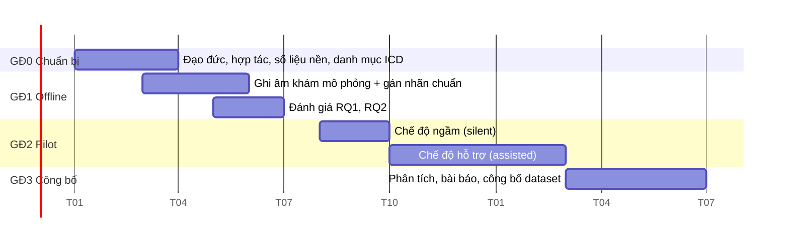
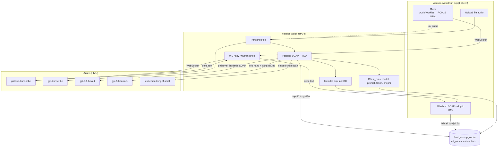
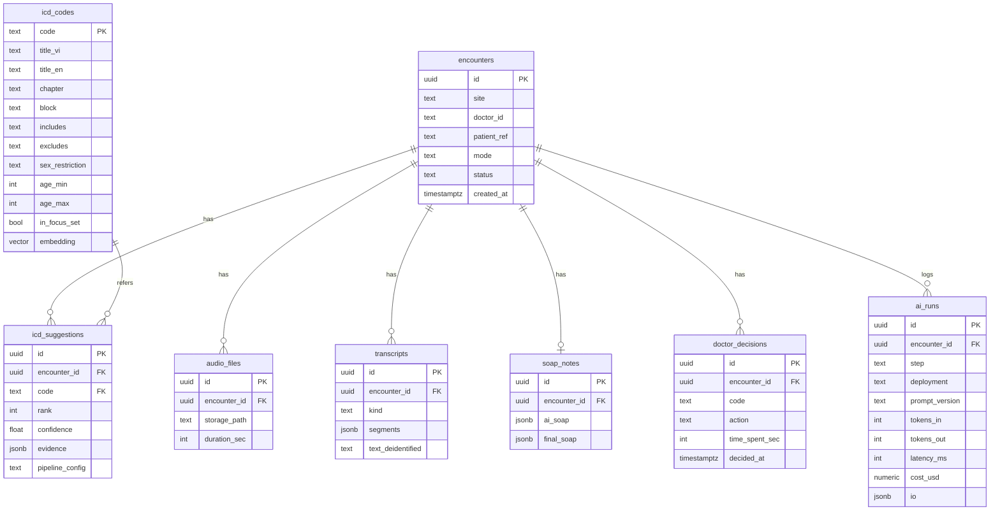

# ViScribe-ICD — Hướng dẫn đề tài & lộ trình MVP

> **ViScribe-ICD: AI ghi chép lâm sàng và mã hoá ICD-10 cho tiếng Việt**
> Tên đầy đủ: *Đánh giá độ chính xác và tác động lâm sàng của hệ thống AI hỗ trợ ghi chép bệnh án SOAP và gợi ý mã ICD-10 từ hội thoại khám bệnh tiếng Việt.*

Tài liệu này dành cho cả nhóm nghiên cứu lẫn dev. Phần A nói về **đề tài** (để viết thuyết minh, xin duyệt). Phần B nói về **cách làm source code MVP**.

---

## Mục lục

- [Phần A — Đề tài nghiên cứu](#phần-a--đề-tài-nghiên-cứu)
  - [A1. Vấn đề & khoảng trống](#a1-vấn-đề--khoảng-trống)
  - [A2. Mục tiêu & câu hỏi nghiên cứu](#a2-mục-tiêu--câu-hỏi-nghiên-cứu)
  - [A3. Phạm vi](#a3-phạm-vi)
  - [A4. Thiết kế nghiên cứu & tiến độ](#a4-thiết-kế-nghiên-cứu--tiến-độ)
  - [A5. Chỉ số đánh giá](#a5-chỉ-số-đánh-giá)
  - [A6. Đạo đức, pháp lý, bảo mật](#a6-đạo-đức-pháp-lý-bảo-mật)
  - [A7. Sản phẩm đầu ra](#a7-sản-phẩm-đầu-ra)
  - [A8. Rủi ro & giải pháp](#a8-rủi-ro--giải-pháp)
- [Phần B — Hướng làm MVP source code](#phần-b--hướng-làm-mvp-source-code)
  - [B1. Tài nguyên AI](#b1-tài-nguyên-ai-azure--hivn)
  - [B2. Kiến trúc tổng thể](#b2-kiến-trúc-tổng-thể)
  - [B3. Cấu trúc repo](#b3-cấu-trúc-repo)
  - [B4. Tech stack](#b4-tech-stack)
  - [B5. Pipeline chi tiết](#b5-pipeline-chi-tiết)
  - [B6. Mô hình dữ liệu](#b6-mô-hình-dữ-liệu)
  - [B7. API backend](#b7-api-backend)
  - [B8. Giao diện frontend](#b8-giao-diện-frontend)
  - [B9. Lộ trình MVP theo sprint](#b9-lộ-trình-mvp-theo-sprint)
  - [B10. Quy ước code & bảo mật](#b10-quy-ước-code--bảo-mật)
  - [B11. Definition of Done của MVP](#b11-definition-of-done-của-mvp)
- [Việc cần chốt ngay](#việc-cần-chốt-ngay)

---

# Phần A — Đề tài nghiên cứu

## A1. Vấn đề & khoảng trống

**Vấn đề thực tế**
- Bác sĩ dành nhiều thời gian ghi chép bệnh án, nên ít thời gian giao tiếp với bệnh nhân.
- Khi mã ICD-10 bị sai hoặc thiếu độ chi tiết (chỉ đúng mã 3 ký tự, thiếu ký tự thứ 4), hồ sơ BHYT có thể bị xuất toán. Thống kê bệnh tật và dịch tễ cũng bị lệch.
- Mã hoá ICD-10 cần người có chuyên môn, mà nhiều cơ sở không có đủ người mã hoá chuyên trách.

**Khoảng trống khoa học** (đây là điểm "bán" đề tài)
- Chưa có **bộ dữ liệu chuẩn công khai** cho bài toán *hội thoại khám bệnh tiếng Việt → SOAP → ICD-10*.
- Độ chính xác của các model nhận dạng giọng nói (STT) và LLM thế hệ mới với thuật ngữ y khoa tiếng Việt chưa được đo một cách có hệ thống. Thuật ngữ y khoa tiếng Việt còn lẫn nhiều tên thuốc và từ Latin hoặc tiếng Anh, và mỗi vùng miền có giọng khác nhau.
- Chưa có bằng chứng về **tác động lâm sàng**, gồm thời gian, chất lượng và an toàn, khi đưa AI ghi chép vào môi trường khám bệnh ở Việt Nam.

> ⚠️ **Cần bổ sung số liệu nền thật** từ cơ sở đối tác để đưa vào thuyết minh: tỉ lệ xuất toán do sai mã, số phút ghi chép trung bình mỗi ca, số ca/ngày. Không bịa số. Nếu chưa có, đưa việc thu thập số liệu nền vào Giai đoạn 0.

## A2. Mục tiêu & câu hỏi nghiên cứu

**Mục tiêu chung:** Xây dựng và đánh giá một hệ thống AI có **bác sĩ là người quyết định cuối cùng** (human-in-the-loop). Hệ thống chuyển hội thoại khám bệnh tiếng Việt thành ghi chép SOAP và gợi ý mã ICD-10.

| # | Câu hỏi nghiên cứu | Cách trả lời |
|---|---|---|
| **RQ1** | Model STT (`gpt-transcribe`, `gpt-live-transcribe`) chép hội thoại khám bệnh tiếng Việt chính xác đến đâu? | Tính WER, CER và **tỉ lệ lỗi thuật ngữ y khoa (MTER)**, phân tầng theo vùng miền, độ ồn, có hay không có từ tiếng Anh/Latin |
| **RQ2** | Gợi ý ICD-10 của hệ thống chính xác đến đâu so với người mã hoá chuyên nghiệp? Cách tiếp cận nào tốt nhất? | So sánh 3 cấu hình: **(a)** LLM tự sinh mã, **(b)** RAG tra danh mục bằng embedding, **(c)** RAG + terra xếp hạng lại + kiểm tra quy tắc. Đo top-1/top-5 ở 3 mức: chương, mã 3 ký tự, mã 4 ký tự |
| **RQ3** | Dùng hệ thống trong thực tế có giúp bác sĩ không, và có an toàn không? | Đo thời gian ghi chép, mức đồng thuận về mã, SUS, tỉ lệ AI bịa thông tin (hallucination), tỉ lệ bác sĩ duyệt mà không sửa (automation bias) |

## A3. Phạm vi

Thu hẹp phạm vi giúp đề tài dễ được duyệt và dễ đo kết quả:

- **Một chuyên khoa / một bối cảnh**, ví dụ khám ngoại trú chăm sóc ban đầu hoặc nội tổng quát. Có thể chọn nhóm bệnh mà tổ chức đang phục vụ. *(Cần chốt.)*
- **Khoảng 200 mã ICD-10 phổ biến nhất** của chuyên khoa đó. Hệ thống vẫn tra được toàn bộ danh mục, nhưng chỉ đánh giá chính thức trên tập mã này.
- **Chỉ mã chẩn đoán ICD-10.** Không làm mã thủ thuật và không kê đơn.
- **Ngôn ngữ:** tiếng Việt, có lẫn thuật ngữ tiếng Anh và Latin.
- **Vai trò của AI:** *hỗ trợ ghi chép và mã hoá*. AI **không** đưa ra chẩn đoán thay bác sĩ. Bác sĩ luôn là người xác nhận.

## A4. Thiết kế nghiên cứu & tiến độ

Tổng thời gian dự kiến 18 tháng:



**Giai đoạn 0 — Chuẩn bị (tháng 1–3)**
- Ký thoả thuận hợp tác với cơ sở y tế. Nộp hồ sơ xin duyệt Hội đồng đạo đức trong nghiên cứu y sinh học.
- Thu thập số liệu nền (xem A1).
- Nạp danh mục ICD-10 tiếng Việt của Bộ Y tế vào hệ thống. Chọn tập khoảng 200 mã trọng tâm.
- Dựng MVP (Phần B).

**Giai đoạn 1 — Đánh giá offline (tháng 3–7)**
- **Ghi âm khám mô phỏng.** Bác sĩ hoặc sinh viên y đóng vai bệnh nhân theo kịch bản dựng từ ca bệnh thật đã ẩn danh. Cách này tránh dùng audio của bệnh nhân thật ở giai đoạn đầu. Mục tiêu khoảng 200–300 cuộc hội thoại, đủ cả 3 giọng Bắc/Trung/Nam.
- **Gán nhãn chuẩn (gold standard):**
  - Transcript chuẩn do người chép tay và hiệu đính.
  - **Hai người mã hoá độc lập** gán mã ICD-10. Hai người lệch nhau thì người thứ ba phân xử. Báo cáo mức đồng thuận bằng Cohen's κ.
- Chạy 3 cấu hình (a)/(b)/(c) để trả lời RQ1 và RQ2.

**Giai đoạn 2 — Pilot thực tế (tháng 8–14)**
- 10–20 bác sĩ, 500–1000 lượt khám, bệnh nhân đồng ý tham gia bằng văn bản.
- **Chế độ ngầm:** AI chạy nhưng bác sĩ không thấy kết quả. Dùng giai đoạn này để so kết quả của AI với cách bác sĩ làm hiện tại.
- **Chế độ hỗ trợ:** bác sĩ thấy gợi ý và tự duyệt hoặc sửa. Có thể thiết kế chéo (crossover), mỗi bác sĩ luân phiên có AI và không AI theo tuần.
- Trả lời RQ3.

**Giai đoạn 3 — Phân tích & công bố (tháng 15–18)**

## A5. Chỉ số đánh giá

| Nhóm | Chỉ số |
|---|---|
| STT | WER, CER, MTER (tỉ lệ lỗi thuật ngữ y khoa), độ trễ realtime |
| SOAP | Mức đầy đủ thông tin (theo checklist), tỉ lệ thông tin bịa (thông tin không có trong hội thoại), điểm chất lượng do bác sĩ chấm (thang PDQI-9 rút gọn) |
| ICD-10 | Top-1/Top-5 accuracy ở mức chương / 3 ký tự / 4 ký tự, precision/recall đa nhãn, tỉ lệ mã không hợp lệ (mục tiêu = 0) |
| Lâm sàng | Thời gian ghi chép/ca, tỉ lệ bác sĩ sửa gợi ý, tỉ lệ duyệt mà không sửa gì, SUS, tỉ lệ hồ sơ bị xuất toán (nếu đo được) |
| Vận hành | Chi phí AI/ca, độ trễ đầu-cuối, tỉ lệ lỗi và lỗi 429 |

## A6. Đạo đức, pháp lý, bảo mật

- **Đồng ý tham gia:** bệnh nhân và bác sĩ đều ký phiếu đồng ý. Phiếu nói rõ cuộc khám được ghi âm và dữ liệu được xử lý bằng dịch vụ AI đám mây đặt ở nước ngoài.
- **Dữ liệu sức khoẻ là dữ liệu cá nhân nhạy cảm.** Audio và text hiện được gửi sang Azure ở West US 3 và Canada Central, tức là có **chuyển dữ liệu ra nước ngoài**. Cần lập hồ sơ đánh giá tác động theo quy định bảo vệ dữ liệu cá nhân hiện hành. Đồng thời hỏi admin HIVN xem có thể deploy ở region châu Á không.
- **Ẩn danh hoá:** dữ liệu lưu để nghiên cứu và dataset công bố phải bỏ hết thông tin định danh (tên, SĐT, địa chỉ, số BHYT, CCCD...).
- **Định vị sản phẩm:** công cụ *hỗ trợ ghi chép và mã hoá* dùng trong phạm vi nghiên cứu, bác sĩ quyết định cuối cùng. Cách định vị này tránh việc bị xếp vào nhóm trang thiết bị y tế chẩn đoán.
- **Lưu trữ:** chỉ giữ audio thô trong thời gian cần cho đánh giá, sau đó xoá theo đề cương đã được duyệt.

> Các căn cứ pháp lý cụ thể (luật bảo vệ dữ liệu cá nhân, văn bản về bệnh án điện tử, thông tư về Hội đồng đạo đức, QĐ hướng dẫn mã hoá ICD-10 của BYT) cần được **cán bộ pháp chế hoặc Hội đồng đạo đức của cơ sở đối tác xác nhận phiên bản hiện hành** trước khi đưa vào thuyết minh.

## A7. Sản phẩm đầu ra

1. **ViScribe-ICD Bench:** bộ dữ liệu benchmark tiếng Việt đã ẩn danh hoá, gồm audio mô phỏng, transcript chuẩn, SOAP chuẩn và mã ICD chuẩn.
2. **Phần mềm mã nguồn mở** ViScribe-ICD (repo này).
3. **1–2 bài báo khoa học:** một bài đánh giá offline (RQ1, RQ2), một bài đánh giá pilot lâm sàng (RQ3).
4. **Hướng dẫn triển khai an toàn** AI ghi chép lâm sàng cho cơ sở y tế Việt Nam.

## A8. Rủi ro & giải pháp

| Rủi ro | Giải pháp |
|---|---|
| Dữ liệu ra nước ngoài, không được Hội đồng đạo đức duyệt | Giai đoạn 1 chỉ dùng hội thoại mô phỏng. Ẩn danh hoá trước khi lưu. Xin region châu Á nếu có |
| AI bịa mã hoặc bịa triệu chứng | Chỉ cho chọn mã trong danh mục, kiểm tra quy tắc, bắt buộc trích bằng chứng từ transcript, bác sĩ duyệt |
| Bác sĩ tin AI quá mức | Đo tỉ lệ duyệt mà không sửa. Giao diện bắt buộc thao tác chọn, không tự động điền sẵn |
| Quota thấp (STT 10 request/phút) | Hàng đợi + retry/backoff. Pilot giới hạn 10–20 bác sĩ |
| Model bị cập nhật làm kết quả không lặp lại được | Ghi phiên bản model, prompt và tham số cho **mỗi** lần gọi AI (bảng `ai_runs`) |
| Hết credit $2000 | Đo chi phí mỗi ca từ sprint đầu, đặt ngưỡng ngân sách, đưa chi phí cloud vào ngân sách đề tài |

---

# Phần B — Hướng làm MVP source code

## B1. Tài nguyên AI (Azure — HIVN)

| Việc | Deployment | Resource / biến `.env` | Giới hạn | Ghi chú kỹ thuật |
|---|---|---|---|---|
| Realtime STT | `gpt-live-transcribe` | `AZURE_STT_*` (Canada Central) | 10 request/phút | **Chỉ dùng được qua WebSocket**. URL bắt buộc có `intent=transcription`. Audio đầu vào: PCM16 mono 24 kHz, base64 |
| STT từ file | `gpt-transcribe` | `AZURE_STT_*` | 10K token/phút, 10 request/phút | **Phải dùng client `AzureOpenAI` + `api_version`**. Gọi qua `/openai/v1/` sẽ lỗi `DeploymentNotFound` |
| Chat nhanh | `gpt-5.6-luna-1` | `AZURE_OPENAI_*` (West US 3) | 100K token/phút | Dùng để phân vai, ẩn danh hoá, trích xuất SOAP |
| Chat suy luận | `gpt-5.6-terra-1` | `AZURE_OPENAI_*` | 100K token/phút | Dùng để xếp hạng và chọn mã ICD |
| Embedding | `text-embedding-3-small` | `AZURE_OPENAI_*` | 150K token/phút | Vector 1536 chiều |

- Hai resource có **key riêng**. Dùng key chat để gọi STT (hoặc ngược lại) sẽ bị lỗi 401.
- Tên deployment khác tên model: phải dùng `gpt-5.6-luna-1`, không phải `gpt-5.6-luna`.
- Nếu dùng thư viện `websockets` bản 13.x thì truyền header qua `extra_headers`. Từ bản 14 trở đi đổi thành `additional_headers`.

## B2. Kiến trúc tổng thể



**Quyết định cho MVP:** dùng **WebSocket relay qua backend** cho realtime. Trình duyệt gửi PCM về backend, backend chuyển tiếp sang Azure. Cách này giống đúng ví dụ đã chạy thử trong hướng dẫn HIVN, đơn giản và key không bao giờ ra khỏi server. Sau MVP có thể cân nhắc chuyển sang WebRTC với ephemeral key (`POST /openai/v1/realtime/client_secrets`) để giảm độ trễ.

## B3. Cấu trúc repo

```
viscribe-icd/
├── README.md
├── docs/
│   ├── HUONG_DAN_DE_TAI.md        # tài liệu này
│   ├── adr/                       # ghi lại các quyết định kiến trúc
│   └── prompts.md                 # mô tả prompt và phiên bản
├── viscribe-api/                  # backend (Python)
│   ├── pyproject.toml
│   ├── .env.example
│   ├── alembic/                   # migration DB
│   ├── viscribe_api/
│   │   ├── main.py                # FastAPI app
│   │   ├── config.py              # đọc .env (pydantic-settings)
│   │   ├── azure_clients.py       # 2 client: chat/embedding và STT
│   │   ├── routers/               # encounters, transcribe, icd, ws
│   │   ├── pipeline/
│   │   │   ├── transcribe.py      # gpt-transcribe + live relay
│   │   │   ├── diarize.py         # luna: gán vai BS/BN
│   │   │   ├── deidentify.py      # luna + regex: ẩn danh hoá
│   │   │   ├── soap.py            # luna: trích SOAP (JSON)
│   │   │   ├── icd_retrieve.py    # embedding + pgvector top-k
│   │   │   ├── icd_rank.py        # terra: chọn mã + bằng chứng
│   │   │   └── icd_rules.py       # kiểm tra hợp lệ, giới/tuổi, loại trừ
│   │   ├── prompts/               # prompt dạng file, có version
│   │   ├── models/                # SQLAlchemy models
│   │   └── schemas/               # Pydantic schemas (I/O + JSON output của LLM)
│   ├── scripts/
│   │   └── load_icd_catalog.py    # nạp danh mục ICD-10 + tạo embedding
│   └── tests/
├── viscribe-web/                  # frontend (React + TS)
│   ├── package.json
│   └── src/
│       ├── audio/                 # AudioWorklet, resample 24kHz, PCM16
│       ├── pages/                 # EncounterList, EncounterDetail
│       ├── components/            # TranscriptPanel, SoapEditor, IcdReview
│       └── api/                   # client gọi viscribe-api
├── viscribe-eval/                 # (sau MVP) script đánh giá RQ1, RQ2
├── viscribe-data/                 # danh mục ICD, dữ liệu mẫu đã ẩn danh — KHÔNG có dữ liệu thật
└── docker-compose.yml             # postgres + pgvector
```

## B4. Tech stack

| Lớp | Lựa chọn | Lý do |
|---|---|---|
| Backend | Python 3.12, **FastAPI**, Uvicorn | SDK `openai` của Python được hướng dẫn HIVN dùng sẵn. Hỗ trợ WebSocket và async tốt |
| SDK AI | `openai>=1.54`, `websockets`, `python-dotenv` | Theo đúng hướng dẫn HIVN |
| DB | **PostgreSQL 16 + pgvector**, SQLAlchemy 2 + Alembic | Một DB làm được cả dữ liệu nghiệp vụ lẫn vector search. Có thể dùng Supabase |
| Hàng đợi | MVP: `BackgroundTasks` + bảng `jobs`. Sau MVP: `arq` hoặc Redis | Quota STT thấp nên cần hàng đợi và retry |
| Frontend | **React + Vite + TypeScript**, TailwindCSS, TanStack Query | Nhẹ, nhanh, phổ biến |
| Audio browser | Web Audio API + **AudioWorklet** để resample về 24 kHz PCM16 | Đúng định dạng mà `gpt-live-transcribe` yêu cầu |
| Dev | Docker Compose (Postgres), `ruff`, `pytest`, `eslint` | |

## B5. Pipeline chi tiết

### Bước 1 — Thu âm & chép lời
- **Realtime:** trình duyệt gửi chunk PCM khoảng mỗi 100–200 ms lên `/ws/transcribe`. Backend gửi `session.update` (bật `server_vad` để tự cắt câu), rồi chuyển tiếp `input_audio_buffer.append`. Khi nhận event `...transcription.delta` từ Azure, backend đẩy text về UI ngay.
- **Đồng thời lưu file audio** (WebM/Opus hoặc WAV). Kết thúc buổi khám thì chạy `gpt-transcribe` trên file này để có **transcript cuối** chính xác hơn. Pipeline dùng transcript cuối này.
- **Upload file:** đi thẳng tới bước chép lời bằng `gpt-transcribe`.
- File dài cần **cắt thành nhiều đoạn** (theo khoảng lặng hoặc theo thời lượng) để không vượt giới hạn kích thước file và quota.

### Bước 2 — Phân vai & ẩn danh hoá (luna)
- STT không tách người nói, nên dùng luna gán vai `BS` / `BN` / `NGƯỜI_NHÀ` cho từng câu dựa trên ngữ cảnh.
- Ẩn danh hoá: thay tên, SĐT, địa chỉ, số BHYT, CCCD bằng nhãn như `[TÊN]`, `[SĐT]`. Kết hợp regex (số, mã) với LLM (tên riêng). **Bản đã ẩn danh** là bản dùng cho nghiên cứu.

### Bước 3 — Trích xuất SOAP (luna, structured output)
Dùng `response_format` dạng JSON schema để LLM luôn trả về đúng cấu trúc:

```json
{
  "subjective": { "chief_complaint": "...", "hpi": "...", "pmh": "...", "medications": ["..."], "allergies": ["..."] },
  "objective":  { "vitals": { "bp": "...", "hr": "...", "temp": "..." }, "exam": "...", "labs": "..." },
  "assessment": [
    { "diagnosis_text": "Viêm họng cấp do liên cầu", "certainty": "confirmed|suspected|ruled_out",
      "evidence": ["BS: họng đỏ, amidan có mủ...", "BN: sốt 2 ngày..."] }
  ],
  "plan": { "treatment": "...", "tests": "...", "follow_up": "..." }
}
```

Quy tắc trong prompt:
- **Chỉ dùng thông tin có trong transcript.** Thông tin không có thì để trống, không được suy đoán.
- Mỗi chẩn đoán phải kèm `evidence` trích **nguyên văn** từ transcript.

### Bước 4 — Tìm ứng viên ICD (embedding + pgvector)
- Với mỗi `assessment[i].diagnosis_text`, tạo embedding rồi tìm **top-30** mã gần nhất trong bảng `icd_codes`.
- Văn bản để tạo embedding cho mỗi mã ICD được ghép như sau:
  `"{code} | {tên tiếng Việt} | {tên tiếng Anh} | Bao gồm: ... | Từ đồng nghĩa: ..."`
- Có thể kết hợp thêm tìm kiếm từ khoá (Postgres full-text, `unaccent`) để không bỏ sót những trường hợp khớp chính xác tên bệnh.

### Bước 5 — Chọn & xếp hạng mã (terra)
Đưa vào terra: SOAP, transcript đã ẩn danh, và danh sách 30 mã ứng viên kèm mô tả. Terra trả về:

```json
{
  "suggestions": [
    { "diagnosis_index": 0, "code": "J02.0", "rank": 1, "confidence": 0.86,
      "rationale": "Viêm họng cấp, có bằng chứng liên cầu...",
      "evidence_quotes": ["BS: test nhanh liên cầu dương tính"],
      "is_primary": true }
  ]
}
```

- **Chỉ được chọn mã có trong danh sách ứng viên.** Mã nào nằm ngoài danh sách thì backend loại ngay.

### Bước 6 — Kiểm tra quy tắc (code, không dùng LLM)
- Mã có tồn tại trong danh mục và đủ độ chi tiết (ưu tiên mã 4 ký tự nếu có).
- Ràng buộc giới tính và tuổi, ví dụ mã sản khoa chỉ áp dụng cho nữ.
- Hai mã cùng được chọn không được loại trừ lẫn nhau.
- Câu trích bằng chứng phải **thực sự có** trong transcript (so khớp chuỗi hoặc fuzzy). Không khớp thì gắn cờ `unverified_evidence`.

### Bước 7 — Bác sĩ duyệt
- Bác sĩ chọn hoặc bỏ từng mã, sửa SOAP, rồi bấm **Xác nhận**. Mọi thao tác được ghi vào `doctor_decisions`. Đây chính là dữ liệu để trả lời RQ3.

### Ghi log cho nghiên cứu
**Mỗi** lần gọi AI đều ghi một dòng vào `ai_runs`:
- deployment, phiên bản prompt, tham số
- token vào/ra, độ trễ, chi phí ước tính
- input và output (đã ẩn danh)

## B6. Mô hình dữ liệu



Giải thích một số trường:
- `encounters.patient_ref`: mã giả danh, **không** lưu tên bệnh nhân.
- `encounters.mode`: `silent` (chế độ ngầm) hoặc `assisted` (chế độ hỗ trợ).
- `transcripts.kind`: `live` (realtime) hoặc `final` (bản cuối).
- `icd_suggestions.pipeline_config`: cấu hình đã sinh ra gợi ý (a, b hoặc c), để so sánh trong RQ2.
- `doctor_decisions.action`: `accept`, `reject`, `add` hoặc `edit`.

## B7. API backend

| Method | Endpoint | Mô tả |
|---|---|---|
| `POST` | `/encounters` | Tạo buổi khám (chọn chế độ silent/assisted) |
| `GET` | `/encounters/{id}` | Lấy chi tiết: transcript, SOAP, gợi ý ICD |
| `WS` | `/ws/transcribe?encounter_id=` | Relay realtime tới `gpt-live-transcribe` |
| `POST` | `/encounters/{id}/audio` | Upload file audio |
| `POST` | `/encounters/{id}/transcribe` | Chạy `gpt-transcribe` để ra transcript cuối |
| `POST` | `/encounters/{id}/generate` | Chạy pipeline phân vai → ẩn danh → SOAP → ICD (đây là nút **"Gen"**) |
| `GET` | `/icd/search?q=` | Bác sĩ tự tìm mã (embedding + từ khoá) |
| `POST` | `/encounters/{id}/confirm` | Bác sĩ xác nhận SOAP và các mã ICD |
| `GET` | `/admin/usage` | Token, chi phí, số lỗi 429 theo ngày |

## B8. Giao diện frontend

**Màn hình 1 — Danh sách buổi khám:** nút tạo mới và trạng thái của từng buổi (đang ghi, đã gen, đã xác nhận).

**Màn hình 2 — Buổi khám** (chia 3 cột):
1. **Transcript:** nút Ghi âm/Dừng hoặc Upload. Text realtime hiện dần. Mỗi câu gắn nhãn BS/BN.
2. **SOAP:** 4 khối S/O/A/P, sửa được trực tiếp. Bấm vào một câu bằng chứng thì transcript được tô sáng ở đoạn tương ứng.
3. **ICD-10:** mỗi chẩn đoán có danh sách mã gợi ý (mã, tên, độ tin cậy, lý do, bằng chứng), kèm ô chọn và ô tìm mã thủ công. Có nút **Xác nhận & lưu**.

Nguyên tắc giao diện:
- **Không chọn sẵn** mã nào, bác sĩ phải tự chọn (để giảm việc tin AI quá mức).
- Ghi chú rõ trên giao diện: "Gợi ý của AI — bác sĩ chịu trách nhiệm xác nhận".
- Ở chế độ `silent`, cột 3 bị ẩn với bác sĩ.

## B9. Lộ trình MVP theo sprint

Mỗi sprint kéo dài 2 tuần.

| Sprint | Mục tiêu | Kết quả kiểm tra được |
|---|---|---|
| **S1 — Nền tảng** | Khung monorepo, docker-compose Postgres + pgvector, `config.py`, 2 Azure client, script smoke test gọi đủ 5 deployment | `pytest` smoke test xanh. Có `.env.example` |
| **S2 — Danh mục ICD** | Nạp danh mục ICD-10 VN vào `icd_codes`, tạo embedding, API `/icd/search` | Tìm "viêm họng" ra J02.x trong top-5 |
| **S3 — Chép lời** | Upload và `gpt-transcribe` (có cắt đoạn, retry). WS relay realtime và AudioWorklet ở frontend | Nói vào micro thấy chữ chạy. Upload file 10 phút ra transcript |
| **S4 — SOAP** | Phân vai, ẩn danh hoá, SOAP JSON có bằng chứng. Màn hình SOAP | 10 hội thoại mẫu ra SOAP hợp lệ theo schema |
| **S5 — ICD** | Truy xuất top-30, terra xếp hạng, kiểm tra quy tắc. Màn hình duyệt ICD, xác nhận và lưu | 0 mã không hợp lệ. Lưu đủ `doctor_decisions` |
| **S6 — Sẵn sàng nghiên cứu** | Bảng `ai_runs` và `/admin/usage`, chế độ silent/assisted, chuyển đổi cấu hình (a)/(b)/(c), export dữ liệu đánh giá | Chạy được 3 cấu hình trên cùng một tập hội thoại và export ra CSV |

Sau S6, bắt đầu `viscribe-eval` (tính WER, MTER, top-k, κ) để phục vụ Giai đoạn 1.

## B10. Quy ước code & bảo mật

- **Không commit `.env`.** Chỉ commit `.env.example`. Thêm `.env`, `*.wav`, `*.mp3`, `*.webm`, `viscribe-data/raw/` vào `.gitignore`.
- Key Azure chỉ nằm ở backend. Frontend **không bao giờ** gọi trực tiếp tới Azure.
- **Không đưa dữ liệu bệnh nhân thật vào repo**, kể cả trong test fixture. Chỉ dùng hội thoại mô phỏng.
- Prompt lưu thành file trong `prompts/`, có số phiên bản (`soap.v1.md`). Đổi prompt thì tăng version.
- Mọi lời gọi Azure đi qua một wrapper chung để có retry/backoff cho lỗi 429, timeout và ghi log `ai_runs`.
- Log ứng dụng **không** in nội dung transcript chưa ẩn danh.
- Repo để **Private** cho tới khi công bố.

## B11. Definition of Done của MVP

- [ ] Bác sĩ ghi âm realtime **hoặc** upload file → bấm **Gen** → thấy SOAP và gợi ý ICD-10 có bằng chứng → duyệt → lưu.
- [ ] 100% mã gợi ý là mã hợp lệ trong danh mục.
- [ ] Mỗi lần gọi AI đều có bản ghi trong `ai_runs` kèm token và chi phí.
- [ ] Chạy được 3 cấu hình (a)/(b)/(c) và export kết quả để đánh giá.
- [ ] Có chế độ silent/assisted.
- [ ] Đã đo chi phí trung bình mỗi ca và độ trễ đầu-cuối.

---

## Việc cần chốt ngay

1. **Chuyên khoa / bối cảnh** cho đề tài (quyết định tập ~200 mã trọng tâm).
2. **Cơ sở y tế đối tác** và đầu mối Hội đồng đạo đức.
3. **Người mã hoá ICD** có chứng chỉ (ít nhất 2 người) để gán nhãn chuẩn.
4. **Nguồn file danh mục ICD-10 tiếng Việt** của Bộ Y tế (định dạng Excel/CSV) để nạp ở Sprint 2.
5. Hỏi admin HIVN về khả năng **deploy ở region châu Á** và quota STT cao hơn cho giai đoạn pilot.
6. Quỹ tài trợ mục tiêu: NAFOSTED, VinIF, Bộ KH&CN, Gates Grand Challenges, Wellcome, Microsoft AI for Good... (cần kiểm tra đợt gọi hồ sơ hiện tại). Mẫu thuyết minh của quỹ sẽ quyết định cách trình bày Phần A.
