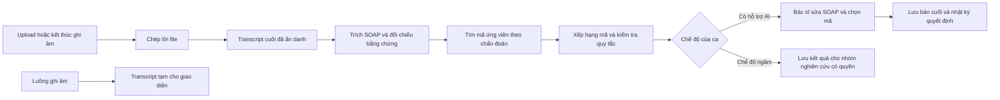

# ViScribe-ICD — Thiết kế backend để duyệt

Bản thiết kế cho MVP dùng ca mô phỏng. Màn hình đã duyệt gồm Transcript, Ghi chép SOAP và Duyệt ICD-10. Tài liệu này cần được duyệt trước khi triển khai logic lõi. Nhánh `main` tại commit `68d2ed3` mới có `README.md` và `.gitignore`. Các module backend và migration sẽ được tạo ở Phase 3.

## Luồng một buổi khám



1. **Thu nhận.** Với upload, backend kiểm tra định dạng và giới hạn cấu hình trước khi tạo job chép lời. Với ghi âm, WebSocket chuyển PCM16 mono 24 kHz qua Azure và trả transcript tạm. Khi có file hoàn chỉnh, chạy cùng luồng chép lời file. Đoạn realtime còn dở sau khi mất kết nối được đánh dấu tạm. Giao diện cho phép ghi lại hoặc nạp file mẫu như mock đã duyệt.
2. **Transcript cuối.** Chép file qua deployment `gpt-transcribe`. Với file cần chia, ghép theo thứ tự và giữ mốc thời gian nếu dịch vụ cung cấp. Gán vai `doctor`, `patient`, `companion` hoặc `unknown`. Dùng bộ nhận diện định dạng và bộ phân loại văn bản để thay định danh bằng nhãn. Gán ID đoạn ổn định cho bản đã ẩn danh và dùng bản này để đối chiếu bằng chứng.
3. **Tạo SOAP.** Tác vụ Luna trả dữ liệu theo schema. Trường chưa có trong hội thoại dùng `null` hoặc mảng rỗng. Assessment ghi lại nhận định được nói trong hội thoại, mức xác định và trích dẫn. Kết quả sai schema hoặc không đối chiếu được bằng chứng đi theo quy tắc dưới đây. Bác sĩ vẫn thấy transcript để sửa bản nháp.
4. **Gợi ý ICD-10.** Với assessment đủ điều kiện, tìm tối đa 30 ứng viên theo từng assessment qua embedding 1536 chiều và pgvector. Terra chỉ được chọn từ tập ứng viên của assessment tương ứng. Backend xác thực mã, bằng chứng và quy tắc trước khi cho chọn trên giao diện.
5. **Xác nhận.** Bác sĩ có thể sửa SOAP, chọn/bỏ gợi ý hoặc tìm mã thủ công. Một giao dịch lưu bản cuối và các quyết định, gồm `accept`, `reject`, `add` và chỉnh sửa SOAP. Giữ bản AI gốc và bản đã xác nhận để so sánh khi đánh giá.

## Quy tắc SOAP và ICD-10

| Tình huống | Kết quả đề xuất |
| --- | --- |
| Nhận định `confirmed` do bác sĩ nói và có trích dẫn hợp lệ | Được đưa vào bước tìm mã. Mức chi tiết dựa trên lời nói và danh mục đã chốt. |
| Nhận định `suspected`, `ruled_out` hoặc nguồn phát ngôn chưa rõ | Giữ trong SOAP nếu có bằng chứng và ghi rõ mức xác định. Mặc định MVP chỉ đưa `confirmed` vào gợi ý ICD tự động. Bác sĩ có thể tự tra mã. |
| Trích dẫn thiếu hoặc sai | So khớp đoạn theo ID và kiểm tra trích dẫn trên transcript đã ẩn danh, cho phép chuẩn hóa khoảng trắng. Gắn cờ `unverified_evidence` khi không khớp và `unsupported_detail` khi trích dẫn có thật nhưng thiếu dữ kiện bắt buộc cho mã. Cả hai cờ đều khóa ô chọn gợi ý và hiển thị lý do như trong mock. |
| Mã ngoài ứng viên, không tồn tại hoặc hết hiệu lực trong phiên bản danh mục của ca | Loại khỏi gợi ý và ghi lý do kỹ thuật. Mã nhập tay cũng phải có trong danh mục của ca. |
| Mã chi tiết hơn bằng chứng hoặc thiếu dữ kiện giới/tuổi | Dùng mã tổng quát hợp lệ nếu có căn cứ. Trường hợp cần xác minh dữ kiện thì hiển thị yêu cầu bác sĩ kiểm tra. Chỉ áp dụng ràng buộc có nguồn trong danh mục. |
| Xung đột loại trừ đã xác minh giữa hai mã | Hiển thị lý do khi bác sĩ chọn và trả lỗi xác nhận cho tập mã xung đột. |
| Bác sĩ xác nhận với danh sách mã rỗng | Cho lưu SOAP sau bước kiểm tra trước khi lưu ghi rõ “Chưa có mã ICD-10”, theo luồng mock đã duyệt. |

Điểm xếp hạng từ AI, nếu hiển thị, là điểm của lần sinh gợi ý. Đề xuất chỉ dùng điểm này để sắp xếp. Điều kiện chọn mã dựa trên bằng chứng và quy tắc, không đặt ngưỡng từ điểm đó trong MVP.

### Ví dụ bằng chứng từ ca mô phỏng

Transcript cuối có đoạn `seg_005` tại `00:34`: “Tôi ghi nhận viêm họng cấp, chưa xác định tác nhân.” Backend lưu vị trí của câu trích dẫn sau khi đối chiếu. Gợi ý `J02.9` trong ví dụ trỏ về `seg_005`. Nếu `J02.0` trỏ tới cùng câu, backend vẫn khóa vì đoạn đó thiếu căn cứ về tác nhân liên cầu.

```json
{
  "assessmentId": "a_01",
  "diagnosisText": "Viêm họng cấp, chưa xác định tác nhân",
  "certainty": "confirmed",
  "evidence": [{"segmentId": "seg_005", "quote": "viêm họng cấp, chưa xác định tác nhân"}],
  "suggestions": [
    {"code": "J02.9", "rank": 1, "selectable": true},
    {"code": "J02.0", "rank": 2, "selectable": false, "reason": "unsupported_detail"}
  ]
}
```

## Hợp đồng API đề xuất

| Endpoint | Đầu vào và kết quả chính |
| --- | --- |
| `POST /encounters` | Chế độ ca và mã tham chiếu giả danh. Trả `201` và `id`. |
| `GET /encounters`, `GET /encounters/{id}` | Danh sách theo quyền truy cập, trạng thái, transcript và kết quả theo chế độ. Chi tiết có `revision` để đối soát phiên bản. |
| `POST /encounters/{id}/audio` | File multipart. Trả `201` và `audioId` sau khi lưu thành công. |
| `WS /ws/transcribe?encounter_id=…` | Kiểm tra quyền trên ca trước khi chuyển tiếp. Backend trả event `delta`, `complete` hoặc `error`. |
| `POST /encounters/{id}/transcribe` | Nhận `audioId`. Trả `202` và `jobId`. |
| `POST /encounters/{id}/generate` | Nhận `transcriptId` của bản cuối đang được dùng. Trả `202` và `jobId`. Ở chế độ ngầm, hệ thống kích hoạt bước này ở backend. |
| `GET /encounters/{id}/jobs/{jobId}` | Trả trạng thái công việc và mã lỗi ngắn để giao diện hiển thị thử lại. |
| `POST /encounters/{id}/jobs/{jobId}/retry` | Đưa job đã thất bại và còn đúng phiên bản đầu vào về hàng đợi. Trả `202` và dùng lại `jobId`. |
| `GET /icd/search?q=…` | Tìm theo mã hoặc tên. Với ngữ cảnh ca, tìm trong đúng phiên bản danh mục của ca. |
| `POST /encounters/{id}/confirm` | Nhận `revision`, SOAP đã sửa và danh sách mã bác sĩ chọn. Trả bản đã lưu. `409` nếu bản nháp đã đổi hoặc ca đã được xác nhận khác nội dung. `422` nếu tập mã vi phạm quy tắc. |

Mỗi ca theo các trạng thái `created`, `audio_ready`, `transcribing`, `transcript_ready`, `generating`, `review_ready`, `confirmed`. Với ca chế độ ngầm, kết quả AI hoàn tất được lưu nội bộ. API dành cho bác sĩ chỉ trả trạng thái thu âm và transcript, không trả SOAP do AI sinh, mã gợi ý hoặc thông tin lỗi của tác vụ sinh nháp. Kiểm tra quyền này áp dụng trên API đọc, WebSocket và bản xuất. Bản xuất nghiên cứu có quyền riêng.

## Job, lỗi và nhật ký

- Dùng bảng job có ràng buộc duy nhất theo loại tác vụ, ca và phiên bản đầu vào. Khi bấm lại với cùng phiên bản, trả về job đã có. Worker nhận job với thời hạn giữ quyền xử lý. Chỉ worker còn giữ quyền tại thời điểm ghi mới được cập nhật kết quả. Provider có thể đã xử lý một yêu cầu trước khi worker gặp lỗi, nên mỗi lần gọi lại được ghi riêng để đối soát chi phí. Ghi kết quả kèm phiên bản đầu vào để lần xử lý trễ không đè bản mới hơn.
- Giới hạn theo deployment. Với HTTP `429` hoặc lỗi tạm thời, tôn trọng `Retry-After` nếu có, sau đó dùng backoff có jitter và số lần thử hữu hạn. Khi hết lượt, giữ file và transcript để giao diện cho thử lại. Kiểm tra quota thực tế ở Phase 3 theo tài liệu HIVN.
- Xác nhận dùng `Idempotency-Key`, phiên bản bản nháp và giao dịch cơ sở dữ liệu. Cùng khóa và cùng nội dung trả lại kết quả cũ. Cùng khóa nhưng đổi nội dung hoặc xác nhận trên phiên bản cũ trả `409`. Một lần xác nhận thành công chỉ ghi một bộ quyết định.
- Ghi mỗi lần gọi Azure và mỗi lượt thử trong `ai_runs`, gồm công đoạn, deployment, phiên bản prompt nếu áp dụng, kết quả, độ trễ, token và chi phí ước tính khi có dữ liệu. Nhật ký lỗi đi qua mã lỗi và metadata. Transcript thô chỉ nằm trong luồng xử lý được phân quyền. Tích hợp hiện tại gửi audio gốc đến STT trước khi có transcript để ẩn danh, nên nghiệm thu MVP dùng dữ liệu mô phỏng.

## Các ca duyệt thiết kế

| Ca mô phỏng | Điều cần thấy |
| --- | --- |
| Upload file và tạo nháp | Nhận transcript cuối, SOAP đúng cấu trúc và gợi ý liên kết đến đoạn trích. |
| Ghi realtime bị ngắt | Transcript tạm được phân biệt với bản cuối. Có đường ghi lại hoặc dùng upload. |
| Chẩn đoán đã loại trừ hoặc gợi ý sai mã | Assessment giữ đúng mức xác định. Mã ngoài danh mục hoặc ngoài ứng viên bị loại. |
| Trích dẫn không có trong transcript | Gợi ý mang cờ thiếu bằng chứng và không thể chọn trực tiếp. |
| Azure trả 429 hoặc tác vụ hết thời gian | Giao diện hiện trạng thái có thể thử lại. Transcript cuối vẫn còn. Nhật ký ghi các lượt thử. |
| Hai lần bấm tạo nháp hoặc xác nhận | Cùng dữ liệu dùng lại job hoặc kết quả. Một lần lưu có hiệu lực. |
| Bác sĩ xem ca ở chế độ ngầm | Không thể lấy kết quả SOAP/ICD qua UI hoặc API dành cho bác sĩ. Xuất đánh giá chỉ khả dụng với quyền nghiên cứu. |

Các nội dung cần duyệt trước khi triển khai là phạm vi chẩn đoán được gợi ý tự động, cách khóa mã không đủ bằng chứng, và cách xử lý bản nháp khi người dùng thử lại hoặc xác nhận trên phiên bản cũ. Quy tắc phụ thuộc danh mục tiếng Việt sẽ được chốt với người có chuyên môn ở Phase 3.
